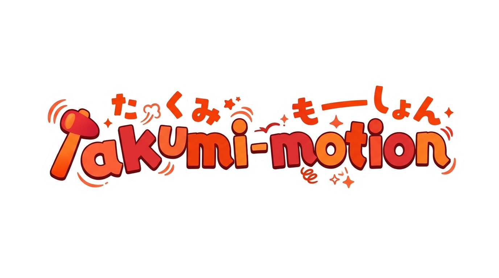

<div align="center">
  
  <p>
    <strong>Deterministic server-side animation engine: any React component or raw HTML string → GIF/WebP/APNG/PNG-sequence/sprite-sheet/still at any user-given surface, rendered by Rust (takumi).</strong><br/>
    v1.0 <em>Velocity</em> — the performance pass: solver/tween/compile/evaluate memoization (geomean <strong>1.71×</strong>), binary-search chunk indexing, zero-copy GIF passes, min-SAD PNG filtering (<strong>−90%+</strong> atlas bytes), and worker-pool parallel capture — byte-identical at any worker count.
  </p>
  <p>
    
    
    
    
    
    
    
  </p>
</div>

---

## Overview

Takumi Motion is a declarative, deterministic animation engine that bridges high-level React component trees or raw HTML with high-performance, server-side rendering. By compiling animation timelines ahead of time and delegating rasterization to a Rust backend (`takumi`), it guarantees byte-exact, reproducible outputs without the runtime overhead, layout thrashing, or non-determinism of traditional browser-based animation libraries.

## Key Features

- **v1.0 Velocity (performance)**: memoized spring solvers, binary-search tween sampling,
  structural compile dedupe, identity-memoized track resolution, zero-copy GIF hold collapse,
  and the standard min-SAD PNG filter heuristic — geomean 1.71× across 13 benches
  (`docs/BENCHMARKS.md`), differential-tested byte-identical against the frozen v0.9.1 pipeline.
- **Worker-pool parallel capture**: `renderReactBanner({ bannerModule, workers: "auto" })` runs
  the capture stage across worker threads; an adaptive gate (cores × frames × measured work)
  only spawns when it wins.


- **Data Motion & Charts**: Deterministic chart primitives (`LineChart`, `BarChart`, `Donut`, `CountUp` v2) that react to a static data channel injected at setup, ensuring no network fetches occur during render.
- **Measured FLIP (`<Morph>`)**: Layout truth with `TM_LAYOUT_SHIFT` auditing. Interpolates position and size channels directly during prewarm, preventing text stretching or elliptical dots common in scale-based FLIP techniques.
- **Material Pack**: Declarative alpha masks (`<Mask>`), directional reveals (`<Reveal>`), variable font weight tracks (`<VariableText>`), and background-clip text fills (`<GradientText>`).
- **Deterministic Particles**: O(1) per-frame closed-form particle systems (`sparkle`, `confetti`) using seeded randomness (`mulberry32`), ensuring byte-identical replays across any frame index.
- **Forever Reel**: `<Banner loop>` with `enter="wrap"` or `exit="wrap"` guarantees byte-identical seams between the last and first frames, verified by `report.seam`.
- **X-ray Auditing**: Per-frame channel attribution (`--explain`) and labeled PNG storyboard contact sheets for precise size-budget instrumentation and visual QA.

## Installation

```bash
pnpm add takumi-motion
```

## Quick Start

Define a banner using React components, orchestrate scenes, and render it server-side to a deterministic format.

```tsx
import { defineBanner, Banner, Scene, Layer } from "takumi-motion/react";
import { renderReactBanner } from "takumi-motion";

export const launchBanner = defineBanner(function TakumiMotionLaunch() {
  return (
    <Banner preset="readme" theme="tokyo-night" transitionMs={250}>
      <Layer bottom>
        <div style={{ position: "absolute", bottom: 0, width: 850, height: 3, backgroundColor: "#7aa2f7" }} />
      </Layer>
      
      <Scene duration={100} enter="rise" exit="crossfade">
        <h1 style={{ fontSize: 48, fontWeight: 700, color: "#c0caf5" }}>
          takumi-motion
        </h1>
      </Scene>
    </Banner>
  );
});

// Render server-side to WebP (or GIF, APNG, PNG-sequence, still)
const report = await renderReactBanner({ 
  banner: launchBanner, 
  format: "webp",
  out: "./out/launch-banner.webp"
});

console.log(report.lint); // Review authoring lint warnings (e.g., TM_LAYOUT_SHIFT)

// v1.0 — heavy banners: parallel capture across worker threads (byte-identical output;
// the auto gate only spawns when cores × frames × measured work amortize it).
const parallel = await renderReactBanner({
  bannerModule: "./launch-banner.tsx", // module entry — the file's default export
  workers: "auto",
});
```

## CLI Usage

The engine provides a comprehensive CLI for rendering, auditing, and scaffolding.

```bash
# Render a banner to default formats
takumi-motion render banner.tsx --preset readme --out ./out

# Render with a specific data file for chart primitives
takumi-motion render banner.tsx --data metrics.json --format webp

# Audit a banner for layout shifts and seam integrity (ideal for CI gates)
takumi-motion check banner.tsx

# Generate an engine-exact filmstrip preview (byte-deterministic)
takumi-motion render banner.tsx --filmstrip

# Preview the captured CSS in the browser (approximate layout)
takumi-motion preview banner.tsx -o banner-preview.html

# Scaffold a new banner project or list available resources
takumi-motion init
takumi-motion templates | presets | fonts
```

## Development

> [!NOTE]
> This project uses `tsx` for execution and `vitest` for testing. Ensure dependencies are installed before running local scripts.

```bash
# Install dependencies
pnpm install

# Build the project
pnpm run build

# Run the comprehensive Vitest suite
pnpm run test

# Run visual QA and smoke tests
pnpm run smoke

# Extract test fixtures
pnpm run fixtures
```

## Authoring & Best Practices

- **Style Safety**: Always use camelCase for style properties (e.g., `fontWeight`, not `font-weight`). React 19 serializes kebab-case keys in a way that causes Rust parse errors in takumi. The linter will catch this as `TM_KEBAB_STYLE`.
- **Determinism**: Never use `Math.random()` or network fetches inside render functions. Use the provided `randomFor` utilities or inject data via the `data` channel at setup.
- **Performance**: Settled animation descriptors return `null`, emitting no style overrides. This allows the chunk-merger to effectively collapse static frames, drastically reducing output file size.

For detailed guidelines on adding new animation primitives, handling layout shifts, and configuring chart primitives, refer to [`docs/AUTHORING.md`](docs/AUTHORING.md).
